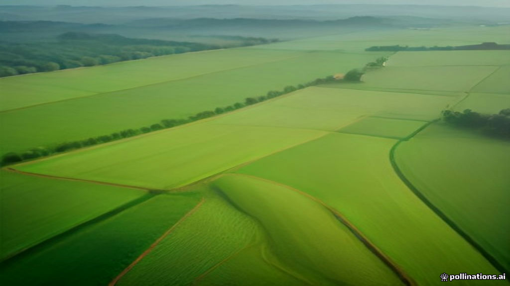

# AgroSphere

**AI-powered agricultural technology platform for Indian farmers.**

AgroSphere is a real, modular, backend-integrated web application — not a static
UI prototype. Every screen talks to a FastAPI backend with a normalized database,
server-enforced role permissions, an auditable approval workflow, a drone-mission
simulator and a provider-independent AI analysis service.



---

## What is included

| Area | Status |
| --- | --- |
| FastAPI backend, 59 passing end-to-end tests | ✅ |
| 5 server-enforced roles (farmer, agronomist, farm manager, drone operator, super admin) | ✅ |
| 18-step crop-health workflow with illegal-transition blocking | ✅ |
| Geospatial field boundaries (GeoJSON) with computed acreage | ✅ |
| Provider-independent AI analysis with uncertainty and escalation | ✅ |
| Drone mission simulation with pre-flight checks and labelled telemetry | ✅ |
| Payments sandbox with signed webhooks and idempotency | ✅ |
| Tamper-evident SHA-256 audit hash chain | ✅ |
| 22 Indian languages + English, light/dark/system themes | ✅ |
| Generative artwork for every module | ✅ |
| Offline-first sync queue in the client | ✅ |

## Architecture

```
backend/app/
  main.py         FastAPI app: 59 routes, auth, workflow, reports, static frontend
  models.py       SQLAlchemy 2.0 models (users, farms, fields, cases, jobs, invoices…)
  security.py     PBKDF2 password hashing, HMAC tokens, role dependencies
  constants.py    Roles, 18 workflow states, transitions, 22 languages
  seed.py         Idempotent demo data seeding
  services/
    ai.py         Pluggable AI provider (simulated by default, live when configured)
    core.py       Audit chain, notifications, workflow engine, payments
    geo.py        Spherical polygon area, boundary validation, mission simulation
frontend/
  index.html      Single-page app shell
  assets/css/     Material-3-inspired design system, themes, responsive layout
  assets/js/      core.js (API/i18n/UI primitives) + app.js (shell, routing, 15 views)
  assets/images/  Generative module artwork
scripts/
  generate_images.py  Pollinations image generator for every module
  e2e_test.py         59-assertion end-to-end API suite
docs/
  ARCHITECTURE.md     Deeper design notes and security model
```

## Quick start

```bash
pip install -r backend/requirements.txt
python3 -m backend.app.seed                 # create DB + demo data
python3 -m uvicorn backend.app.main:app --host 0.0.0.0 --port 8000
```

Open <http://localhost:8000>. Interactive API docs are at `/docs`.

### Demo accounts

All demo accounts use the password `agro1234`.

| Role | Email |
| --- | --- |
| Farmer | `farmer@agrosphere.in` |
| Agronomist | `agronomist@agrosphere.in` |
| Farm manager | `manager@agrosphere.in` |
| Drone operator | `operator@agrosphere.in` |
| Super admin | `admin@agrosphere.in` |

## Tests

With the server running:

```bash
python3 scripts/e2e_test.py
```

The suite exercises the real HTTP API — no mocks — and asserts authentication,
RBAC denials, the full workflow, illegal transitions, drone simulation, payment
idempotency, webhook signature rejection, report disclaimers, notification
delivery evidence and audit-chain integrity. Expected result: **59 passed, 0 failed**.

## The 18-step workflow

```
draft → imagery_captured → analysis_running → ai_findings_ready
  → awaiting_agronomist → plan_prepared → awaiting_manager
  → plan_approved → awaiting_farmer → implementation_chosen
  → job_assigned → in_progress → completed → follow_up → closed
```

Reachable detours: `rejected`, `needs_revision`, `reopened`. Each transition is
validated server-side against both the state graph and the caller's role, and
appends an immutable audit event with a reason.

## AI provider configuration

The default analysis service is a deterministic simulator whose output is always
labelled as simulated. To enable a live provider:

```bash
export AGROSPHERE_AI_PROVIDER=openai
export AGROSPHERE_AI_API_KEY=sk-...
export AGROSPHERE_AI_MODEL=gpt-4o-mini
```

`GET /api/meta` reports the active mode so the interface can label it honestly.

## Safety and honesty guarantees

AgroSphere deliberately does **not** claim capabilities it does not have:

- **No spraying command is issued.** Drone missions run in simulation mode and all
  telemetry carries a `simulated: true` flag and a human-readable label.
- **AI findings are preliminary.** They carry uncertainty, an alternative
  hypothesis and an escalation flag; they are never presented as a diagnosis.
- **Affected-area estimates** are only produced when geospatial or calibration
  data permits, rather than invented from a single photograph.
- **Payment success** is only recorded from a signature-verified server webhook,
  never from a client success screen.
- **Language support** is labelled as pending native validation rather than
  claimed as production-ready.
- **A software emergency-stop is not physical shutdown** and is described as such.

## Generative artwork

Every module has distinct generative artwork produced by `scripts/generate_images.py`
using the free Pollinations `flux` model. The script is idempotent and rate-limit
aware. Regenerate everything with:

```bash
python3 scripts/generate_images.py --force
```

## License

Provided as a demonstration implementation. Review product-safety, chemical-use
and data-protection requirements with qualified professionals before any real
field deployment.
